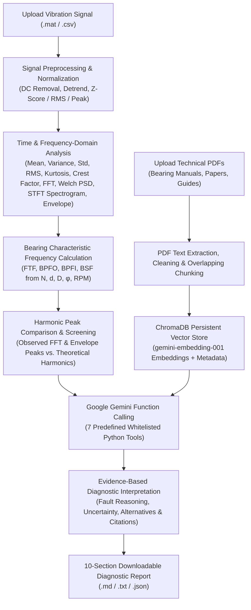

# VibraMind AI — An LLM-Powered Industrial Bearing Fault Diagnosis Assistant

**VibraMind AI** is a modular, end-to-end industrial decision-support platform designed for rolling-element bearing fault diagnosis. Developed as an M.Tech project, it combines classical multi-domain digital signal processing (time-domain statistics, Fast Fourier Transform, Welch Power Spectral Density, Short-Time Fourier Transform spectrograms, and Hilbert envelope demodulation) with **ChromaDB Retrieval-Augmented Generation (RAG)** and **Google Gemini Function Calling**.

Instead of relying on black-box classification or unverified LLM estimates, VibraMind AI enforces a strict engineering separation of concerns:
1. **Deterministic Python Signal Processing (`NumPy` / `SciPy`)** computes all numerical measurements, spectra, and zero-slip kinematic bearing characteristic frequencies (`FTF`, `BPFO`, `BPFI`, `BSF`).
2. **ChromaDB Vector Retrieval (`gemini-embedding-001`)** retrieves relevant passages from uploaded bearing manuals, maintenance guides, and research papers with exact document and page citations.
3. **Google Gemini Function Calling (`google-genai` SDK)** orchestrates predefined Python tools and synthesizes transparent, evidence-backed diagnostic interpretations and downloadable reports.

---

## System Architecture



### Project Directory Layout

```text
VibraMind-AI/
├── frontend/
│   └── app.py                         # 4-section industrial Streamlit dashboard
├── src/
│   ├── config.py                      # Environment & runtime settings
│   ├── logger.py                      # Application logging
│   ├── signal_processing/
│   │   ├── loader.py                  # MATLAB (.mat flat & nested structs) and CSV/TXT loaders
│   │   ├── preprocessing.py           # Input validation, detrending & normalization
│   │   ├── features.py                # Time-domain statistical indicators
│   │   ├── bearing_frequencies.py     # Kinematic FTF, BPFO, BPFI, BSF & presets (MFPT, CWRU)
│   │   ├── spectrum.py                # FFT, Welch PSD, STFT, spectrogram, bandpass & Hilbert envelope
│   │   ├── comparison.py              # Observed peak extraction & harmonic fault comparison
│   │   ├── plots.py                   # Interactive Plotly visualizations
│   │   ├── pipeline.py                # Unified signal-processing pipeline
│   │   └── synthetic.py               # Realistic synthetic bearing signal generator
│   ├── rag/
│   │   ├── pdf_loader.py              # Page-by-page PDF text extraction & cleaning (pypdf)
│   │   ├── chunker.py                 # Overlapping semantic text chunker with metadata
│   │   └── vector_store.py            # ChromaDB PersistentClient & search_bearing_knowledge()
│   ├── llm/
│   │   ├── gemini_client.py           # Official google-genai Interactions & Embedding client
│   │   ├── tools.py                   # 7 whitelisted Python tools for Gemini Function Calling
│   │   └── prompts.py                 # System instructions & diagnostic report templates
│   └── diagnosis/
│       ├── engine.py                  # Rule-based spectral + envelope screening engine
│       └── interpreter.py             # Tool-enabled Q&A and 10-section report builder
├── data/                              # Built-in MFPT & CWRU vibration files (.mat & .csv) + ChromaDB storage
├── knowledge_base/                    # Technical bearing manuals & research papers (.pdf)
├── tests/                             # Unit & end-to-end integration test suites (pytest)
├── .env.example                       # Template environment configuration
└── requirements.txt                   # Pinned Python dependencies
```

---

## Four Main Application Sections

1. **Section 1 — Dashboard (`📊 1. Dashboard`)**:
   - Displays project overview, KPI metrics (uploaded/available vibration signals, indexed technical documents and chunks, recent signal analyses, active Gemini model), one-click benchmark dataset loaders (MFPT & CWRU), recent analysis log table, and Knowledge Base management.
2. **Section 2 — Signal Analysis (`📈 2. Signal Analysis`)**:
   - Accepts MATLAB `.mat` and CSV `.csv`/`.txt` vibration signals.
   - Displays time-domain statistical indicators (`Mean`, `Variance`, `Std Dev`, `RMS`, `Kurtosis`, `Crest Factor`).
   - Computes theoretical `FTF`, `BPFO`, `BPFI`, and `BSF` from explicit bearing geometry (`N`, `d`, `D`, `φ`) and shaft `RPM`.
   - Renders interactive Plotly charts for the Original Waveform, FFT Spectrum (with theoretical fault markers and observed peaks), Welch PSD, STFT Spectrogram, and Hilbert Envelope Spectrum, plus a harmonic fault-comparison table.
3. **Section 3 — AI Diagnostic Assistant (`🤖 3. AI Diagnostic Assistant`)**:
   - Conversational assistant powered by Gemini Function Calling and ChromaDB RAG.
   - Automatically invokes predefined Python tools (`analyze_vibration_signal`, `calculate_signal_features`, `perform_fft_analysis`, `calculate_psd`, `calculate_bearing_frequencies`, `compare_fault_frequencies`, `search_bearing_knowledge`) and maintains multi-turn context via `previous_interaction_id`.
4. **Section 4 — Diagnostic Reports (`📑 4. Diagnostic Reports`)**:
   - Generates downloadable 10-section engineering reports (`.md`, `.txt`, `.json`) containing signal metadata, operating conditions, time-domain measurements, FFT/PSD findings, theoretical bearing frequencies, observed-vs-theoretical harmonic comparisons, suspected faults, uncertainty/limitations, retrieved RAG citations, and maintenance recommendations.

---

## Technologies Used

| Layer | Technology | Purpose |
|---|---|---|
| **LLM & Function Calling** | `google-genai` SDK (`gemini-3.5-flash-lite` / `gemini-3.8-flash`) | Natural-language reasoning, tool orchestration, report synthesis |
| **Embeddings** | `gemini-embedding-001` | Semantic vector embeddings for technical PDF chunks |
| **Vector Database (RAG)** | `chromadb` (`PersistentClient`) | Local persistent vector storage and cosine similarity search |
| **Signal Processing** | `numpy`, `scipy` (`fft`, `signal`, `io.loadmat`) | Time-domain features, FFT, Welch PSD, STFT, Hilbert envelope, `.mat` parsing |
| **Data & PDF Processing** | `pandas`, `pypdf` | Tabular CSV loading, PDF text extraction, and comparison tables |
| **Interactive Visualization** | `plotly` | Waveform, FFT, PSD, STFT spectrogram, and envelope spectrum charts |
| **Web Frontend** | `streamlit` | 4-section industrial diagnostic web application |
| **Testing** | `pytest`, `streamlit.testing.v1` | Unit and end-to-end integration tests |

---

## Installation Instructions

1. **Clone or open the repository** and navigate to the `VibraMind-AI` project directory:
   ```powershell
   cd "c:\Users\HP\Desktop\LLM Project\VibraMind-AI"
   ```

2. **Create and activate a Python virtual environment**:
   ```powershell
   python -m venv .venv
   .\.venv\Scripts\Activate.ps1
   ```

3. **Install dependencies**:
   ```powershell
   pip install -r requirements.txt
   ```

---

## Gemini API Configuration

1. Copy `.env.example` to `.env` in the `VibraMind-AI/` root directory:
   ```powershell
   Copy-Item .env.example .env
   ```

2. Edit `.env` and provide your Google Gemini API key:
   ```ini
   GEMINI_API_KEY=your_gemini_api_key_here
   GEMINI_MODEL=gemini-3.5-flash-lite
   GEMINI_EMBEDDING_MODEL=gemini-embedding-001
   ```
   > **Security Note:** Never commit `.env` to version control. The application loads `GEMINI_API_KEY` solely from environment variables via `python-dotenv`.

---

## Dataset Instructions (MFPT & CWRU)

VibraMind AI supports any 1D accelerometer signal stored in **MATLAB `.mat` (v5/v7)** or **CSV / TXT** format:
- **MFPT (Machinery Failure Prevention Technology) Bearing Dataset**:
  - Supports nested MATLAB struct files (`bearing.gs`, `bearing.sr`, `bearing.rate`, `bearing.load`) as well as CSV exports.
  - Built-in MFPT files in `data/`:
    - `data/mfpt_baseline_healthy_97656hz.mat` ($f_s = 97,656\text{ Hz}$, shaft speed $= 25\text{ Hz} / 1500\text{ RPM}$, load $= 270\text{ lbs}$, healthy condition)
    - `data/mfpt_outer_race_fault_48828hz.mat` ($f_s = 48,828\text{ Hz}$, shaft speed $= 25\text{ Hz} / 1500\text{ RPM}$, $\text{BPFO} = 81.12\text{ Hz}$)
    - `data/mfpt_inner_race_fault_48828hz.mat` ($f_s = 48,828\text{ Hz}$, shaft speed $= 25\text{ Hz} / 1500\text{ RPM}$, $\text{BPFI} = 118.88\text{ Hz}$)
    - `data/mfpt_outer_race_fault_48828hz.csv`
  - **MFPT NICE Bearing Geometry Preset**: $N = 8$, roller diameter $d = 5.969\text{ mm}$ ($0.235\text{ in}$), pitch diameter $D = 31.623\text{ mm}$ ($1.245\text{ in}$), contact angle $\phi = 0^\circ$.
- **Case Western Reserve University (CWRU) Bearing Dataset**:
  - Supports standard CWRU `.mat` files (`X*_DE_time`, `X*_FE_time`, `X*RPM`).
  - Built-in CWRU files in `data/`:
    - `data/cwru_6205_bpfo_12khz.mat` ($f_s = 12,000\text{ Hz}$, $1797\text{ RPM}$, $\text{BPFO} = 107.36\text{ Hz}$)
    - `data/demo_outer_race_fault_12khz.csv`
    - `data/demo_healthy_12khz.csv`
  - **CWRU SKF 6205-2RS Bearing Geometry Preset**: $N = 9$, ball diameter $d = 7.94\text{ mm}$, pitch diameter $D = 39.04\text{ mm}$, contact angle $\phi = 0^\circ$.

---

## How to Upload Technical Documents (RAG Knowledge Base)

1. Open the application and expand **📚 Knowledge Base & Technical Document Management (ChromaDB RAG)** in **Section 1 (Dashboard)**.
2. Select a **Document Category** (`Bearing Manufacturer Manual`, `Industrial Maintenance Document`, `Research Paper on Bearing Fault Diagnosis`, or `Vibration Analysis Reference Document`).
3. Upload one or more `.pdf` files and click **Extract, Chunk, Embed & Index PDF(s) in ChromaDB**.
4. The pipeline extracts text page-by-page (`pypdf`), cleans formatting artifacts, splits pages into overlapping chunks with metadata (`document_name`, `page_number`, `chunk_id`, `category`), embeds them with `gemini-embedding-001`, and stores them in `data/chroma_db`.
5. Pre-indexed reference documents in `knowledge_base/`:
   - `SKF_6205_Bearing_Maintenance_Manual.pdf`
   - `Randall_Antoni_Bearing_Envelope_Analysis_Paper.pdf`

---

## How to Run the Application

From the `VibraMind-AI` root directory, run:

```powershell
streamlit run frontend/app.py
```

### Running the Automated Test Suite

To execute all unit and end-to-end integration tests (signal processing, MFPT & CWRU loaders, Gemini Function Calling, ChromaDB RAG citations, diagnostic report generation, and Streamlit UI verification):

```powershell
pytest -v
```
